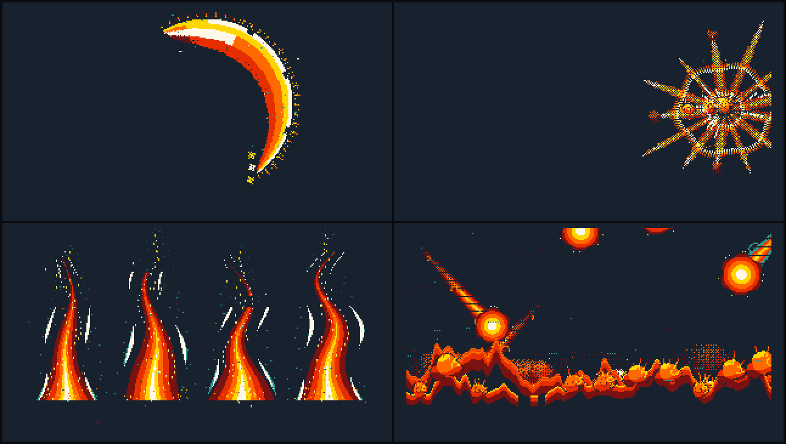

# 山海 boss effects

Four pure boss VFX for a horizontal Metroidvania, drawn at 320 x 180 and built out of one strict eight-colour
palette taken from the boss itself. No monster is drawn: these are the effects alone, so they can be dropped on top
of whatever the game's boss sprite is.



| id | name | what it is |
|---|---|---|
| `beast/claw-rift` | 赤金裂爪 · Scarlet Gold Claw | a three-hit claw combo: a falling crescent of fire with a gold rim, a crossing jade-and-fire X with a bone impact frame, a ground smash that runs gold rune waves out under three twisting fire columns |
| `beast/jade-fire-orb` | 青岚瑞火弹 · Jade Cloud Fireball | jade cloud winds in to a gold core, a comet with a curled 祥云 tail crosses the screen, then either a white-out and a ring burst, or the core dies and the body curls into 青灰 smoke |
| `beast/step-flame-array` | 踏炎连环阵 · Stampede Flame Array | gold cloud-thunder arrays flicker on, a bone afterimage streaks the screen, four jade-and-fire columns erupt in sequence and break up |
| `beast/burn-the-mountains` | 山海焚天 · Sky Burning | the screen dims, a giant bagua drinks the world in, meteors pour down the diagonals and a sea of cloud fire rolls across the floor, then rising sparks |

## the palette

Nothing else is ever drawn. Every "glow" is a hard ramp step, every fade is a 4x4 Bayer dither.

```
骨白 #FFF8E7   明黄 #FFD700   朱红 #E62E00   烈焰橙 #FF6A00
暗红 #7A1212   青碧 #2E9E8F   深青 #16524B   深黛蓝 #18222F
```

Ramps: fire `ink → ember → crimson → flame → gold → bone`, jade `ink → teal → jade → bone`, a dying ember
`bone → gold → flame → crimson → ember → ink`, smoke `ink → ember → teal → jade`.

## the lifecycle

No effect disappears all at once. Each one runs **cast → release → hit or miss → decay**, and the decay is a
lifecycle of its own: the volume collapses from the edges in, big shapes break into separate pixel pieces, colour
walks down the ramp step by step, and the last of it becomes 祥云 curls that thin out on the dither and die.

- `claw-rift`: the crescent whips over in 3 frames, then **hangs** where it landed, narrowing from 34 px to 4 px
  and cooling white → gold → flame → crimson → ember. The columns shrink from the top, and what is left of them
  becomes solid 祥云 smoke that shrinks and dithers out.
- `jade-fire-orb`: the vortex arms are drawn *inward* (widest arc first), the core grows; on a miss the body sags
  and stretches out before it splits into three curls that rise, swell, cool and die on separate beats.
- `step-flame-array`: the jade wind sheath cracks off into pixels first, the fire cores break into floating embers
  after, and each of the four columns goes on its own delay.
- `burn-the-mountains`: the sea ebbs from the middle out, the crests shrink before they are gone, and the outro is
  a sky full of sparks that cool one by one.

## using them

They are ordinary pixelfx effects: `meta.size` is `[320, 180]`, `origin` is `[0, 0]`, so the effect's local
coordinates *are* screen coordinates. Nothing reads `o.actor`.

```js
import { createFrame, clearFrame, createFx, composite } from "pixelfx";
import * as claw from "pixelfx/fx/beast/claw-rift";

const frame = createFrame(320, 180), img = new ImageData(320, 180);
const fx = createFx(claw, { hit: true });          // hit: false for the miss branch

fx.update(1 / 24);
clearFrame(frame);
fx.draw(frame);
composite(frame, img.data, null);                  // null: transparent, ready for a sprite sheet
ctx.putImageData(img, 0, 0);
```

Options: `hit` (`true`/`false`, every effect has both branches), `seed`, plus the usual `x`, `y`, `flip`.
`shake(t)` is exported by all four: it returns the screen offset for host-side shake, and the showcase page uses it.

## the showcase page

`beast-vfx.html` at the repo root is one self-contained file (styles, the four effects and only the core they use,
all inlined, 86 KB, no network). Open it from disk, or:

```sh
node tools/build-beast.mjs --serve        # rebuild and serve on :5050
node tools/serve-beast.mjs 5173           # serve the built page
```

It has the four skills (with the combo split into 1/2/3 and the full chain), the hit and miss branches, five
backgrounds (ink, black, game grey, transparency checkerboard, green screen), 8/12/24/30 fps, frame stepping, a
scrubber, and shake and loop toggles.

### export

All exports are **transparent PNG**, eight colours, no anti-aliasing, at the current fps and branch.

1. **序列帧大图 (sprite sheet)** — one PNG, frames laid out left to right, top to bottom, `columns` capped at 8, plus
   a JSON with `frameWidth: 320`, `frameHeight: 180`, `columns`, `rows`, `frames`, `fps` and `pivot`. Cut it on that
   grid in Aseprite, Godot, Unity or Phaser; the first frame is the top-left cell.
2. **独立 PNG 打包** — a ZIP of every frame (`0000.png`, `0001.png`, …) plus `frames.json` with per-frame times. The
   zip is stored, not compressed, so it opens anywhere without a library.
3. **当前帧** — the frame under the playhead, for one-offs and stills.

A 4.4 s ultimate at 24 fps is 107 frames: a 2560 x 2520 sheet, or 107 files of 320 x 180.

## where the code is

```
src/fx/beast/_lib.js                 the palette, the dither, 祥云 curls, 云雷纹, rune waves, the fire pillar,
                                     the bagua array, slashes, impact frames and the shared particle field
src/fx/beast/claw-rift.js            赤金裂爪
src/fx/beast/jade-fire-orb.js        青岚瑞火弹
src/fx/beast/step-flame-array.js     踏炎连环阵
src/fx/beast/burn-the-mountains.js   山海焚天
src/beast/index.html, stage.js       the showcase page
tools/build-beast.mjs                bundles the page into beast-vfx.html
tools/serve-beast.mjs                serves it
```

`node tools/check.mjs beast` checks all four: they end empty, stay inside the canvas, are deterministic, and draw
nothing outside the eight colours.
