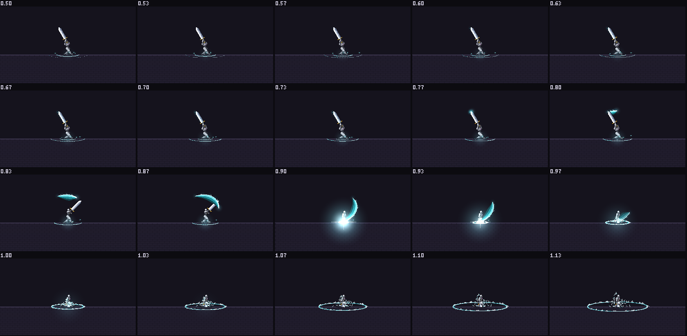
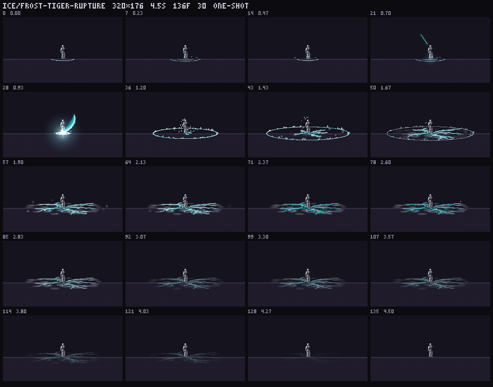

# 霜牙·白虎破 — render / look / refine

`src/fx/ice/frost-tiger-rupture.js` · simulated · 4.5 s · 30 fps · 320×176 · pivot (160,112)

青白霜力贴地收束，举刀提霜后从头顶向下重劈，刀落瞬白，扁平霜环撕开疏密不均、带锯齿分叉的虎斑地裂，最后留下一层缓慢呼吸消退的薄霜。**没有生物、虎形轮廓或虎形虚影。**

## 准备与参考

按指定顺序完整阅读：`skills/pixelfx/SKILL.md` → `docs/AUTHORING.md` → `ground-slam.js` → `frost-nova.js` → `big-explosion.js`。

注意：当前 checkout 的 SKILL.md 只有第 1–4 节，没有所提到的第 5 节。依照任务消息中给出的 house rules 执行 1x 判断与色阶自查，而不是声称读到了不存在的段落。

- `node tools/list.mjs rupture`：开工前 0 个结果。
- `node tools/list.mjs frost`：开工前 13 个结果，没有同名效果。
- `node tools/new.mjs ice/frost-tiger-rupture`：生成正式骨架。
- 渲染并实际打开 torch 的运行检查，以及 ground-slam、frost-nova、big-explosion 的 **1x** 接触表。
- 参考的是库内的贴地 `band`、分层光与分阶段编排；没有复制参考效果的整套造型。

## 三稿：差别在裂纹拓扑，不是换颜色

三个完整 simulated 草稿均使用相同配色和阶段，分别写为 `frost-tiger-rupture-a/b/c.js`，执行：

```sh
node tools/render.mjs "ice/frost-tiger-rupture-*" --zoom 1 --max 20
```

三个 `records/ice/frost-tiger-rupture-{a,b,c}/contact.png` 均逐一实际打开判断。

| 草稿 | 裂纹形态 | 1x 判断 |
|---|---|---|
| A | 八条不等角、不等长放射主干，各自有 1–2 条不同起点和角度的侧枝 | 疏密、尖梢与中心向外的力量最清晰；留下 |
| B | 保留放射主干，加入两层不规则横向连接，形成蛛网破板 | 横向连线削弱虎斑，读成碎玻璃；淘汰 |
| C | 六条主裂隙朝右前方聚束，另两条短裂隙向后反冲 | 重心挤到右侧，像定向劈裂而非环形大招；淘汰 |

A 归位到正式文件；`src/fx` 内所有 a/b/c 草稿均已删除。草稿接触表和迭代过程保留在 ignored `records/`，不作为正式库条目。

## 六轮迭代记录

每轮都执行了 **渲染 → 实际打开 1x contact.png → 指认最差处 → 修改 → 再渲染**；没有以放大接触表代替原生判断。

| 轮次 | 实际看到的问题 | 具体修改 | 复看 |
|---|---|---|---|
| 1 | 3 秒后裂纹变成断续抖动点阵，余霜失去轮廓 | 用继承 painter 的局部线条适配器，将 `polyline` 的像素写入改为真 alpha blend；不修改全局 painter | 连续尖梢保留下来，缓慢消退而非碎成噪点 |
| 2 | 1.9–2.6 秒仍像青色电路，地面结霜不可辨 | 主干宽度从 2–4 提到 3–6；扩大裂纹周围霜盘，另加 32 个随机贴地霜皮小片 | 霜层覆盖到地裂之间，但局部像悬浮白雾 |
| 3 | 白斑像烟团，折线过于闪电化 | 霜盘透视厚度从 0.38 压到 0.23，改为薄层分档透明度；主裂隙加入随机缓弯、缩小短折齿；hero 窗口改为 0.06 s，冲击灯缩到 0.2 s | 霜皮更贴地；导出 MP4，并打开落刀前后连续 12 fps 的 1x act 图 |
| 4 | 远处地裂相对霜环翘起；环齿像围栏 | 地裂平面压缩从 0.28 统一为环的 0.16；碎冰齿 43→29，高度 2–8→1.5–5.5 px | 环与地裂贴合同一地面，碎边不再抢走主干焦点 |
| 5 | 从真实 MP4 解码逐帧图发现恰好 0.900 s 的白闪晚一小步 | 在 1e-9 内将模拟时间对齐 HIT/END；加入 0.900/0.933 s 两帧白核断言 | 重新导出、解码并打开 1x 释放图，0.900/0.933 s 白闪，0.967 s 已转为霜环；act 落刀与命中同帧 |
| 6 | 标准检查虽零警告，额外实测中位绘制约 3.1 ms，未达到质量线 | 将霜盘采样包围盒也投影到地面，去掉逐像素反复三角函数与无效圆形扫描；仍用 `disc` 的真透明写入 | 再渲染、打开最终 1x 接触表，外观保留；中位约 1.17 ms，p95 约 2.63 ms（本机实测，非最坏帧保证） |

本地过程证据：`records/review/frost-tiger-rupture/round-{0..6}.png`、`mp4-release-1x.png`。

## 追加修订：补足重击前置（用户复审）

用户指出原版只有落地霜爆，缺少能独立读出的向下重劈。追加两轮渲染、实际打开原生 contact 与 30 fps 连续 act 图：

1. **先补完整挥刀轨迹**：0.52–0.74 s 沿举起的刀锋亮起窄霜线；0.74–0.90 s 青白宽刀光从头顶绕至右侧，向下劈中原点。轨迹为原创三次 Bezier，终点严格为 (0,-1)，衔接原 0.9 s 白热核心。上举后侧轨迹在 drawBack，落刀段在 draw；不是额外一圈地面光。
2. **复看并修最差处**：第一版起刀短段过厚，像一个亮点；按挥刀进度收窄起手、保留后段 14 px 宽的厚重冷气尾迹，并加少量不等分的冰刃齿。再渲染、打开 contact 与 0.5–1.15 s 的逐帧动作图复看。
3. **身体同步**：增加 0.82 / 0.867 s 的举刃过顶、压身落刀姿势，与 0.9 s 砸地及 hit-stop 对齐。独立导出的效果本身包含刀光，不依赖预览人物才看得到重劈。
4. **时序不拖长**：下劈 0.16 s；刀光残影在 1.02 s 前消失，原有环爆、虎纹地裂、余霜时序及总长均不变。不新增金色、红色或任何生物形象。
5. **回归**：新增 0.8 / 0.833 / 0.867 s 命中前高处刀光的像素断言；原两帧白核、六种 seed、真实 alpha、无越界和终点清空检查全部仍通过。更新图集、contact、逐帧 CSV 与 MP4；`check` 仍为零警告。



动作视频：`records/act/ice-frost-tiger-rupture.mp4`；纯效果视频：`records/ice/frost-tiger-rupture/anim.mp4`。

## 最终预览与导出

原始最终接触表：`records/ice/frost-tiger-rupture/contact.png`。

为 PR 保留一份小型可审阅副本（其他大图集与视频仍在 ignored records）：



```sh
# 1x 原生接触表、MP4 与透明 spritesheet
node tools/render.mjs ice/frost-tiger-rupture --zoom 1 --max 20 --mp4 --scale 1 --sheet
# 只需要导出图集时
node tools/render.mjs ice/frost-tiger-rupture --sheet
# 落刀动作连续帧（1x）
node tools/act.mjs ice/frost-tiger-rupture --zoom 1 --from 0.5 --to 1.15 --step 0.0333333333 --cols 5
# 检查与逐帧审计
node tools/check.mjs ice/frost-tiger-rupture
node tools/test-frost-tiger-rupture.mjs
```

MP4 需要 PATH 中有 ffmpeg。工作环境原本没有，使用安装在工作树之外的 imageio-ffmpeg 所带二进制完成导出，未向项目增加依赖。真实 MP4 为 320×176 / 30 fps / 136 帧（最后的透明终帧占一帧，所以编码时长约 4.53 s）。

- 0–0.74 s 蓄势，0.74–0.9 s 向下重劈；落刀白核与八向 flare 只占 0.900、0.933 s 两个采样帧；0.967 s 转入环扩散，释放小于 0.2 s。
- 冲击环半径上限 116 px，近半环前层，远半环后层；冰屑带重力，落地删除。
- 1.1–1.9 s 生长不规则锯齿裂纹，1.9–2.8 s 冷却、升霜；2.8–4.5 s 为 1.7 秒的缓慢余霜，呼吸 2.5 周期且振幅递减。
- 颜色和光在 `t = duration` 均为空，不靠播放器隐藏尾帧。

## 自查：实测而非估计

`node tools/check.mjs ice/frost-tiger-rupture`：**1 pass / 0 fail / 0 with warnings**。

专项测试覆盖 seed 1/2/3/7/17/42、颜色和光的双缓冲确定性、不同种子造型变化、3/2/1 步短配色、48 px 外边距的逐帧颜色及光越界检查、直接 `create` 的精确终点、两帧白热核心和真实中间 alpha。全部通过。

| 项目 | 最终结果 |
|---|---|
| 图集 | **2880×2816**，9 列 × 16 行，136 帧；单帧 320×176，pivot (160,112) |
| 每帧用色 | 原 color buffer：0–416 个 RGB；叠光后、打包前：0–831；实际导出 PNG：**0–1107** 个 RGB，不计完全透明像素 |
| 逐帧完整计数 | [136 帧 CSV](frost-tiger-rupture-colors.csv)，区分 raw / composited / exported；运行专项测试可重生成 `records/ice/frost-tiger-rupture/audit.json` 与 CSV |
| alpha 是否只有 0/255 | **否**。薄霜、雾、冷却裂纹及导出辉光有中间 alpha，符合真半透明要求；末帧无像素 |
| 越界 | 六个种子的每个采样帧，颜色和光均 0 越界；不依赖 exporter 的边缘淡化遮掩 |
| 随机与配色 | 仅 `new Rng(o.seed)`；主、副、金三阶分别 `fit`，从不串成一条阶梯 |

RGB 计数不是色阶源色数：真 alpha 混合与叠光会生成中间色。导出还沿用现有 `spriteSheet/canvas.paste` 行为，CSV 的 exported 列统计该行为后的 RGB；另用 PNG 解码核对过所有 136 帧计数。

### 四条色阶规则（饱和度采用 HSV S）

| 色阶 | 亮度严格递增 | 最大相邻色相差 | 最亮步饱和度 | 分组 |
|---|---|---|---|---|
| palette | 是 | 2.77° ≤21° | 20.97% ≤40% | 独立青白能量阶 |
| frost | 是 | 5.93° ≤21°（无彩白不比较 hue） | 0% ≤40% | 独立中性霜阶 |
| gold | 是 | 4.00° ≤21° | **85%，不满足 40%** | 独立金属点缀阶 |

**明确的输入冲突**：指定 gold 的最亮色必须是 `#f0b424`，其 HSV S 为 85%，不可能同时满足“最亮步 ≤40%”且保持原样。因此保留用户指定的精确五色，不擅自去饱和，仅在两帧 hero frame 的落点画两个金色点（每帧 2 px）；不能将这项自查伪报为全部通过。主阶和霜阶满足全部数值规则。

## 注册

执行 `node tools/index.mjs`，更新 registry、catalog 和 README 计数。生成器同时收录了仓库原先已有但未登记的八个效果；它们的效果源码没有修改。最终 registry 为 253 项，无任何 a/b/c 草稿条目。
